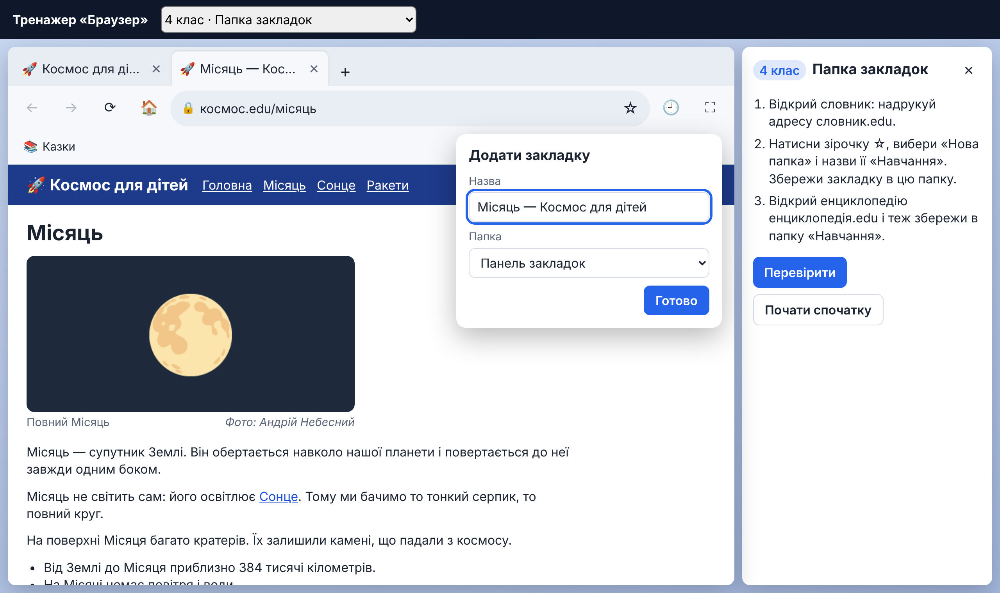

<h1 align="center">edu-browser</h1>

<p align="center">
  <b>A safe, made-up web browser for teaching tabs, addresses, links, bookmarks and history.</b><br>
  Self-checking tasks, a replayable action log and server-side grading. Built for computer science lessons in grades 3–6.
</p>

<p align="center">
  <a href="https://github.com/zavada123/edu-browser/actions/workflows/pages.yml"></a>
  <a href="https://zavada123.github.io/edu-browser/"></a>
  <a href="LICENSE"></a>
  
  
</p>

<p align="center">
  <a href="https://zavada123.github.io/edu-browser/"></a>
</p>

## Why

Children learn to use a browser on the real internet, where the teacher cannot reset the state, cannot check what the student did, and cannot promise safe content. `edu-browser` gives every student the same browser in a browser tab, with a few made-up safe sites, tasks like "bookmark this page" and automatic checking.

It follows the same model as [edu-desktop](https://github.com/zavada123/edu-desktop): a scenario, a log of the student's actions, and goals checked on the server. The student-facing interface is in Ukrainian. It was built for [EduProstir](https://eduprostir.com).

## Features

- **A neutral browser window,** without logos: tabs, «Назад», «Вперед», «Оновити», «Домашня сторінка», the address bar with a lock, the star and the bookmarks bar.
- **Tabs:** new tab (+, Ctrl+T), close (✕, Ctrl+W, middle click), switch (Ctrl+Tab), a link in a new tab (right click, Ctrl+click, middle click, long press on a phone).
- **Address bar:** takes an address or a search query; Cyrillic addresses (`казки.edu`) and Latin aliases (`kazky.edu`); a "site not found" page for typos.
- **Bookmarks:** the star dialog with name and folder, a new folder from the dialog, the bookmarks bar with folders, a bookmark manager (rename, move, delete).
- **History:** grouped by day, search in history, delete one entry, clear all with a confirmation.
- **A search site** that finds pages by keywords, with adverts on top, and a new-tab page with tiles.
- **Safety lessons:** popup windows with a tempting button and a small ✕, a chat where a stranger asks for a password (with «Поскаржитися»), a bait site with a form for personal data, downloads with an antivirus warning, and the 🙋 «Покликати дорослого» button. Forms send nothing and nothing the student types is kept: only the press is recorded.
- **Made-up sites as data:** a page is a list of blocks (heading, text with links, photo with author, links, list, table, banner, search). No HTML from data, no iframes, no network.
- **Learning with the internet:** a school dictionary, two encyclopedias that give different numbers, a photo gallery where every photo has an author and a licence and can be downloaded, and questions in the task card the student answers with what they found.
- **Find on the page and zoom:** «Знайти на сторінці» (Ctrl+F, or the ⋮ menu) highlights every match and counts them; the page zooms from 50 % to 200 % (Ctrl++, Ctrl+−, Ctrl+0, or the ⋮ menu), with a badge that resets it.
- **The lock in the address bar:** a real school diary on `https` next to a copy with the same look on an `http` address with a strange name. A password field hides the letters.
- **Large mode** for grades 3–4, a **phone layout** with a tab list, and **full screen**.
- **Tamper-proof grading:** the server replays the log and checks every step was possible (a "link" step must be a link on that page, a "history" step must be in history).

## Built-in tasks

| Grade | Lesson | Task |
|---|---|---|
| 3 | inf3-09 | Мандрівка посиланнями · Назад і вперед · Адреса казок · Сайт чи сторінка? |
| 3 | inf3-10 | Котик просить пароль · Твій приз — телефон! · Безпечний чи підозрілий? · Файл гри з вірусом |
| 4 | inf3-11 | Перша закладка · Папка закладок · Знайди в історії · Як пишеться? · Перевір у двох джерелах · Чиє фото? |
| 5 | — | Пошук за ключовими словами · Вкладки до ладу · Прибери за собою · Замок у рядку · Знайди на сторінці · Дрібний шрифт |

## Installation

```bash
npm install github:zavada123/edu-browser#<commit>
```

Pin a commit, so that an update never changes how tasks you have already given out are graded. The built package is committed in `lib/`. Peer dependencies: `react` and `react-dom` 19 or newer.

## Usage

### Describe a task

```ts
import type { Scenario } from "edu-browser/core"

const history: Scenario = {
  id: "g4-history",
  grade: 4,
  title: "Знайди в історії",
  large: true,
  task: ["Учора ти читав про лелек, але забув адресу.", "Відкрий історію.", "Знайди сторінку про лелеку і відкрий її."],
  start: {
    tabs: ["пошук.edu"],
    history: [{ url: "космос.edu/сонце" }, { url: "енциклопедія.edu/лелека" }] // day -1: yesterday
  },
  goals: [{ type: "activeTab", url: "енциклопедія.edu/лелека", how: "history" }]
}
```

### Render the trainer

```tsx
import { EduBrowser } from "edu-browser/react"
import "edu-browser/style.css"

<EduBrowser key={scenario.id} scenario={scenario} onCheck={(solved) => console.log(solved)} />

// Server-side check: store the log and submit it as the answer.
<EduBrowser key={scenario.id} scenario={scenario} selfCheck={false} initialOps={savedOps} onChange={setOps} />
```

### Grade on the server

```ts
import { grade } from "edu-browser/core"

const result = grade(scenario, ops)
if (!result.ok) {
  // The log is forged or broken: the step at result.index is impossible.
} else {
  result.solved   // every goal is met
  result.results  // per goal: ok, text and hint
}
```

A log is limited to 500 steps, 20 tabs, 100 bookmarks, 20 folders and 50 downloads.

## API

| Entry point | Contents |
|---|---|
| `edu-browser/react` | The `EduBrowser` component |
| `edu-browser/core` | State, steps (`Op`), goals, `grade`, the built-in sites and `scenarios`, `referenceOps`. No React, safe for Node |
| `edu-browser/style.css` | Styles for the component |

`<EduBrowser>` takes the same props as `<EduDesktop>`: `scenario`, `onCheck`, `onChange`, `initialOps`, `selfCheck`, `next`, plus an optional `web` with your own sites.

### Steps

`navigate` (with `how`: `typed`, `link`, `bookmark`, `history`, `home`), `back`, `forward`, `reload`, `newTab`, `closeTab`, `switchTab`, `addBookmark`, `renameBookmark`, `moveBookmark`, `deleteBookmark`, `addFolder`, `deleteHistory`, `clearHistory`, `submitForm`, `report`, `callAdult`, `closePopup`, `acceptPopup`, `download`, `deleteDownload`, `openDownload`, `find` (the words searched on the page in front), `zoom` (`level`: 50, 67, 75, 80, 90, 100, 110, 125, 150, 175, 200), `answer`.

While a popup is open, only its buttons and `callAdult` are possible, as on the screen.

### Goals

Every goal accepts its own `text` and a `hint` shown when it is not met.

| `type` | Checks that |
|---|---|
| `activeTab` | The page in front is this address; optionally reached this way (`how`: `link`, `typed`, `back`, `history`…) |
| `activeSite` | The page in front is any page of this site |
| `tabOpen` / `tabCount` | A tab shows this page / there are exactly N tabs |
| `siteTabs` | At least N tabs show different pages of one site |
| `visited` / `notVisited` | The student opened / never opened the page (a bare host covers the whole site) |
| `searched` | The student searched for words on the search site |
| `used` | The student used an action: `back`, `forward`, `reload`, `newTab`, `closeTab`, `home`, `deleteHistory`, `clearHistory`, `callAdult`, `report` |
| `bookmark` / `noBookmark` | A bookmark for the page exists (optionally in a folder, with a title) / does not |
| `folder` | A bookmark folder exists |
| `historyHas` / `historyHasNot` / `historyCount` | History holds / does not hold the page / holds N entries |
| `submitted` / `notSubmitted` | The form or chat with this id was / was not sent |
| `popupClosed` | The popup was closed without its tempting button |
| `downloaded` / `downloadDeleted` / `notOpened` | The file was downloaded / deleted / never opened |
| `foundOnPage` | The student searched the page for these words (optionally on this page) |
| `zoom` | The page zoom is at least `min` and/or at most `max` per cent |
| `answer` | The answer to a question of the task (`start.questions`) is one of `accept`; case, extra spaces, quotes, stress marks and apostrophe kinds do not matter |

## Development

```bash
npm install
npm run dev        # demo at http://localhost:5173
npm test           # core tests (Vitest)
npm run build      # type check and build the demo into dist/
npm run build:lib  # build the package into lib/ (commit lib/ with your changes)
```

## License

[MIT](LICENSE). All sites, people and photos are made up. No browser logos are used.
